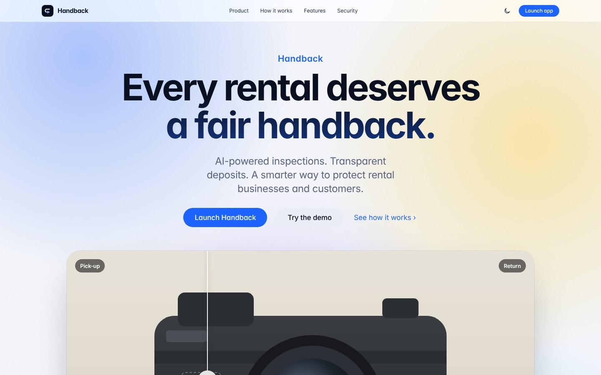
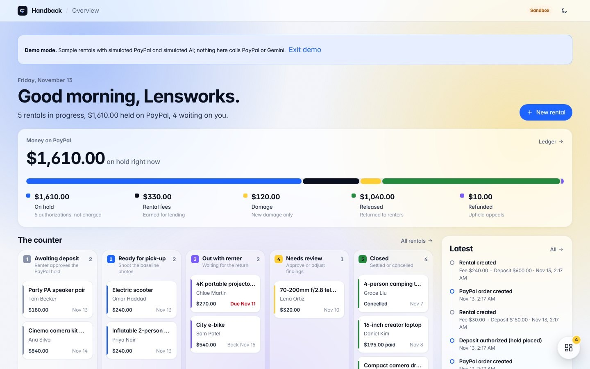
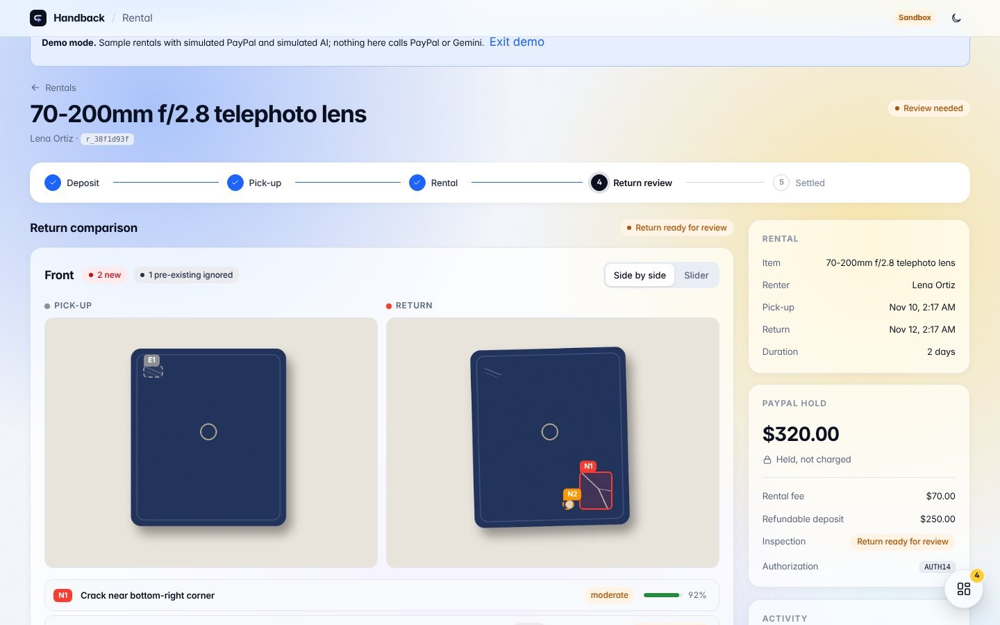
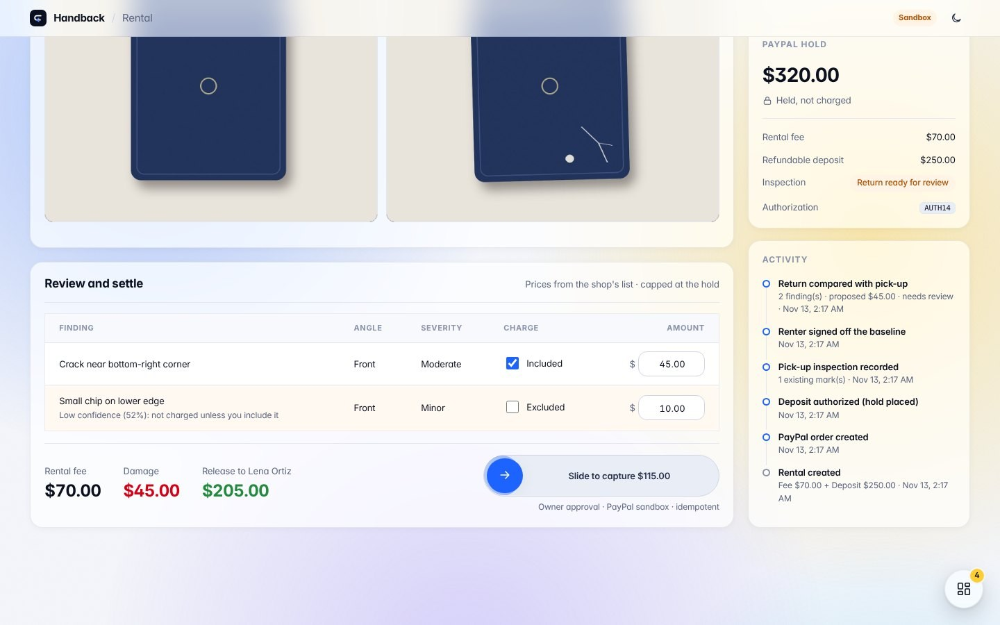
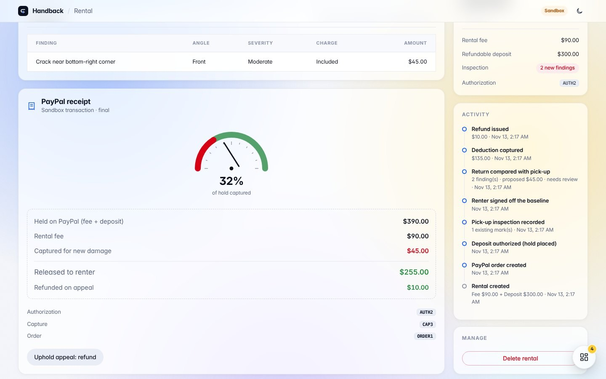
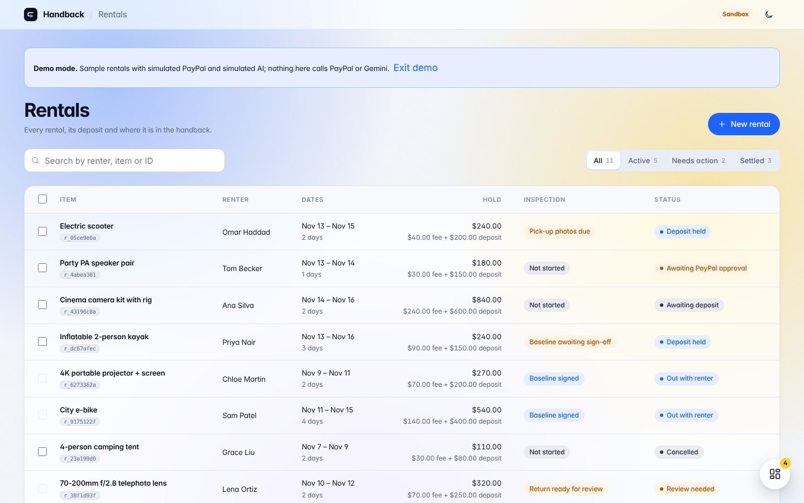
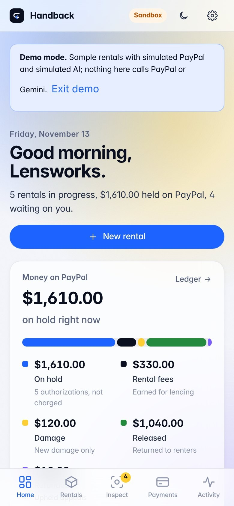
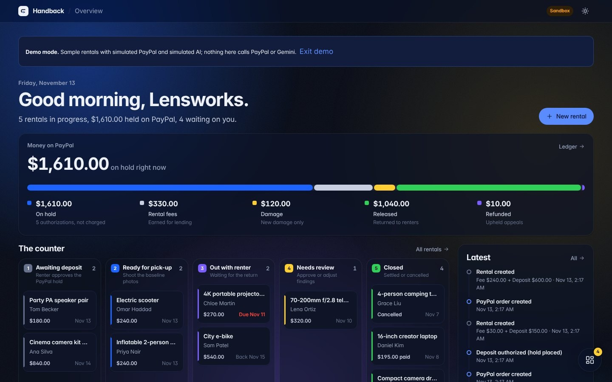

# Handback

**Rent with confidence. Return with proof.**

Rental deposits that settle themselves, fairly: only new damage costs anything.

Handback photographs a rental item at pick-up, records every existing mark, and holds the deposit as a **PayPal authorization** (a hold, not a charge). At return, AI compares the photos, boxes only what is new, and prices it from the shop's own list. The owner approves, and **one PayPal call captures the deduction and releases the rest of the hold**.

Built for the PayPal AI Hackathon 2026 ("Build What's Next with PayPal and AI"). PayPal **sandbox only**: no real money moves.

> Status: PayPal sandbox lifecycle and Gemini vision verified live; full UI built and checked at four screen sizes. See `docs/PROJECT_STATUS.md`.

Open http://localhost:5173 after `npm run dev`: the landing page is at `/`, the app at `/app` (Overview, Rentals, Inspections, Payments, Activity, Settings).

## Preview

> Screenshots use the app's built-in demo data (Settings → Demo data), where PayPal and Gemini are simulated. The same screens run against the real PayPal sandbox and Gemini with `npm run dev`.



**The counter.** Every rental in one of five stages, plus where the money is: on hold, earned as rental fees, kept for damage, released, refunded.



**Return comparison.** Pick-up vs return photos for each angle. Only new damage is boxed; marks the renter signed off at pick-up are ignored.



**Owner review.** Prices come from the shop's list, low-confidence findings are excluded until a person includes them, and one slide captures the fee plus damage.



**PayPal receipt.** One capture with `final_capture: true`; the rest of the hold is released, and appeals refund part of it.



<table>
  <tr>
    <td width="68%"></td>
    <td width="32%"></td>
  </tr>
  <tr>
    <td>Rentals: search, filter, select and delete (live holds are voided first).</td>
    <td>Installable mobile app.</td>
  </tr>
</table>



## Install as a mobile app (PWA)

Handback is an installable web app: home-screen icon, full-screen, phone tab bar, offline shell. `/api` is never cached, so payments and AI checks are always live.

- **Laptop (Chrome or Edge):** open http://localhost:5173/app and click the install icon in the address bar.
- **Phone on the same Wi-Fi:** `npm run dev` prints a `Network:` address such as `http://192.168.1.20:5173`. Open `/app` on that address on the phone.
  - **iPhone (Safari):** Share → Add to Home Screen.
  - **Android (Chrome):** menu → Add to Home screen.
  Full offline install on Android needs HTTPS (any tunnel or host); over plain LAN it opens as a home-screen shortcut.

Colours: Hostinger scheme #22 "Banky" (blue #1D63FF, yellow #FFCE32) on deep ink #0B1020, over a slow-moving gradient background (paused for reduced motion).

## Demo data (no keys needed)

Two ways in:

- **Inside the normal app:** with `npm run dev` running, click **Try the demo** on the landing page (or Settings → Demo data). Click **Exit demo** in the banner to go back. The demo lives in its own workspace (`/demo-api`), so it never mixes with your real sandbox rentals.
- **Standalone, no `.env` at all:**

```bash
npm run demo        # then open http://localhost:5173/app
```

Starts the full app pre-filled with 10 sample rentals, one at every stage: booked, awaiting PayPal approval, deposit held, baseline awaiting sign-off, out with the renter (one overdue), returned with an AI comparison waiting for review, settled with a capture, settled with a void, and captured then part-refunded on appeal. You can push each one forward from the UI: approve the hold, upload `demo/before.jpg` at pick-up and `demo/after.jpg` at return, then approve and settle.

PayPal and Gemini are **simulated** in this mode (the same scripted fakes the tests use, IDs like `AUTH4`, `CAP7`), and a banner says so on every page. Nothing in demo mode calls PayPal or Gemini; use `npm run dev` with your `.env` for the real sandbox integrations.

## Money rules

- **Rental fee:** each item has a daily rate. Fee = started days × rate, shown before the rental is created.
- **PayPal hold = fee + refundable deposit.** Nothing is charged at booking.
- **At return:** one capture of *fee + priced new damage* (`final_capture: true`), damage capped at the deposit; PayPal releases the rest.
- **Cancel before pick-up:** the hold is voided, nothing is charged (no fee for an item that never left).
- **Delete:** allowed for booked, awaiting-approval, held (voided first), cancelled and settled rentals; refused while the item is out or awaiting settlement, so money is never stranded.

The catalogue has 17 items across cameras, electronics, mobility, outdoor and tools, each with its own deposit, daily rate and damage price list (`server/src/seed.ts`).

## How it works

```
Renter approves hold ──► PayPal Orders v2 (intent AUTHORIZE) for rental fee + deposit ── $0 charged
Pick-up photos ───────► Gemini lists existing marks ── renter signs off (the baseline)
Return photos ────────► Gemini: "what is here now that wasn't in the baseline?"
                         └─► code prices new findings from the shop's price list, capped at the hold
Owner approves ───────► Payments v2 capture(fee + damage, final_capture: true) ── rest released
   nothing new ───────► capture(fee only) ── whole deposit released
   cancelled early ───► Payments v2 void ── nothing charged
Appeal upheld ────────► Payments v2 refund (partial)
Long rental ──────────► Payments v2 reauthorize after the 3-day honor period
```

**The AI never touches money.** It only reports findings with boxes and confidence. Prices come from the shop's list, totals are capped at the hold in code, low-confidence findings go to manual review, and only the settlement service (after owner approval, under a per-rental lock, with a deterministic `PayPal-Request-Id`) calls PayPal.

## PayPal APIs used

| Step | API | Code |
| --- | --- | --- |
| Hold the deposit | `POST /v2/checkout/orders` (`intent: AUTHORIZE`) + JS SDK button (`intent=authorize`) | `server/src/paypal/client.ts` |
| Place the hold after approval | `POST /v2/checkout/orders/{id}/authorize` | `server/src/domain/rentals.ts` |
| Charge only new damage | `POST /v2/payments/authorizations/{id}/capture` with `final_capture: true` | `server/src/domain/settlement.ts` |
| Cancel before pick-up | `POST /v2/payments/authorizations/{id}/void` | `server/src/domain/rentals.ts`, `settlement.ts` |
| Long rentals | `POST /v2/payments/authorizations/{id}/reauthorize` (days 4–29) | `server/src/domain/settlement.ts` |
| Appeal | `POST /v2/payments/captures/{id}/refund` | `server/src/domain/settlement.ts` |
| State sync | Webhooks + `POST /v1/notifications/verify-webhook-signature` | `server/src/routes/api.ts` |

## AI design (Google Gemini)

- **Baseline call** (pick-up, one per angle): photo → existing marks `{label, type, severity, box_2d, confidence}` plus a photo-quality check (blurry or wrong angle → retake).
- **Diff call** (return, one per angle): pick-up photo + return photo + the signed baseline → `new_findings` (boxes on the return photo), `matched_preexisting`, `same_item`.
- Structured JSON output (`responseJsonSchema`), validated again with zod; one retry on a fallback model; invalid output never reaches pricing.
- Customer text and text inside photos are treated as untrusted data.

## Quick start

Requirements: Node 20.19+ (22 recommended).

```bash
npm install
cp .env.example .env        # fill in PayPal sandbox + Gemini keys
npm test                    # 31 tests: money rules, state machine, image checks, dashboard maths, full flow
npm run dev                 # API on :8787, web on http://localhost:5173
```

Without keys the app still starts and explains what is missing.

### PayPal sandbox setup (5 minutes)

1. [developer.paypal.com](https://developer.paypal.com) → **Apps & Credentials** → **Sandbox** → **Create App**.
2. Under **Testing Tools → Sandbox Accounts**, create (or use) a **US** business account (the shop) and a **US** personal account (the renter). India-region sandbox accounts block some flows.
3. Copy the app's Client ID and Secret into `.env`.
4. Prove the lifecycle end to end: `npm run spike:paypal` (you approve twice in the browser; it authorizes, partially captures, retries idempotently, refunds and voids).
5. Optional: add a sandbox webhook pointing to `{APP_URL}/api/paypal/webhook` and put its ID in `PAYPAL_WEBHOOK_ID`.

### Gemini

Create a key at [aistudio.google.com/apikey](https://aistudio.google.com/apikey) and set `GEMINI_API_KEY`. Model IDs are configurable (`GEMINI_MODEL`, `GEMINI_FALLBACK_MODEL`).

### Database

Leave `DATABASE_URL` empty for the in-memory store. For a persistent demo, create a free Neon Postgres database, set `DATABASE_URL`, and run `npm run db:schema`.

## Environment variables

| Variable | Required | Purpose |
| --- | --- | --- |
| `PAYPAL_CLIENT_ID` / `PAYPAL_CLIENT_SECRET` | yes | Sandbox REST app credentials (server only; the browser only gets the public client ID) |
| `PAYPAL_WEBHOOK_ID` | optional | Enables webhook signature verification |
| `GEMINI_API_KEY` | yes | Vision checks |
| `GEMINI_MODEL`, `GEMINI_FALLBACK_MODEL` | no | Model IDs |
| `AI_CONFIDENCE_THRESHOLD` | no | Findings below this go to manual review (default 0.6) |
| `SHOP_ADMIN_TOKEN` | yes | Header `x-shop-token` required to approve settlements and refunds |
| `APP_URL` | yes | Used for PayPal return/cancel URLs |
| `DATABASE_URL` | no | Postgres; empty = in-memory |
| `PORT` | no | API port (default 8787) |

`PAYPAL_ENV=live` is refused on purpose.

## API

| Method | Path | Notes |
| --- | --- | --- |
| GET | `/api/config`, `/api/health` | Public client ID and which integrations are configured |
| GET | `/api/events?limit=100` | Recent events across all rentals (read-only) |
| GET | `/api/items` | Rentable items with deposit, angles and price list |
| GET/POST | `/api/rentals` | List / create a rental |
| GET | `/api/rentals/:id` | Rental, item and activity log |
| POST | `/api/rentals/:id/paypal/order` | Create (or reuse) the AUTHORIZE order |
| POST | `/api/rentals/:id/paypal/authorize` | Checks the order is APPROVED, then places the hold |
| POST | `/api/rentals/:id/pickup` | `{photos:[{angle,mimeType,data}]}` → baseline, or retake reasons |
| POST | `/api/rentals/:id/acknowledge` | Renter signs off the baseline |
| POST | `/api/rentals/:id/return` | Return photos → priced proposal |
| POST | `/api/rentals/:id/settle` | **Shop token.** Approved lines → capture or void |
| POST | `/api/rentals/:id/refund` | **Shop token.** Partial refund on appeal |
| POST | `/api/rentals/:id/cancel` | **Shop token.** Cancel before pick-up; voids a live hold |
| DELETE | `/api/rentals/:id` | **Shop token.** Delete a rental (voids a live hold first; refused while the item is out or awaiting settlement) |
| POST | `/api/paypal/webhook` | Verified with PayPal, de-duplicated by event id |

## Project layout

```
server/src/paypal/client.ts     PayPal REST client (OAuth, orders, authorizations, captures, refunds, webhooks)
server/src/ai/                  Gemini vision prompts, JSON schemas, validation
server/src/domain/              money (integer cents), pricing, state machine, rentals, settlement
server/src/store/               in-memory and Postgres stores (advisory locks)
server/test/                    vitest suites with fake PayPal and fake AI
client/src/                     React app: landing page, app shell, rental workflow, inspection comparison (see docs/FRONTEND_DESIGN.md)
scripts/paypal-spike.ts         live sandbox lifecycle proof
docs/                           plan and idea scorecard
```

## Deploy (Render)

`render.yaml` defines one web service that builds the client and serves it with the API. Set the secrets in the Render dashboard; never commit them.

## License

MIT, see `LICENSE`.
